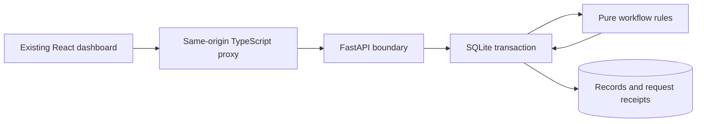

# Architecture and verification boundaries

`api.py` owns credentials, origin/host checks, bounded body reading and HTTP errors. `models.py` defines the typed request envelope. Blocking SQLite work runs in a worker thread. Lifespan initializes the configured store; no default secret is provided.

`domain.py` receives a copy of the current state and produces a result and updated state. It has no HTTP, database or email dependencies. Time can be injected for expiry tests. Server randomness creates identifiers/tokens. Mock scoring preserves the old skill-overlap/answer-length teaching behavior; it is not evidence of candidate suitability.

`store.py` opens a connection per operation, uses parameterized SQL, and begins an immediate transaction before reading records or checking a receipt. It commits changed records and the receipt together. A failed write rolls back both. Concurrent writers serialize through SQLite on the same local file. Tests intentionally fail receipt insertion to verify that no job remains after rollback.

The records table stores typed JSON payloads by primary key, retaining the original workflow's compact aggregate structure. It is not a normalized relational hiring schema: uniqueness of email and job/candidate pairs is implemented by domain rules inside the transaction. Every operation loads the dataset, so this is intentionally for small local demonstrations. A production redesign would need schema migrations, row-level constraints, identity/roles, pagination, retention and realistic provider contracts.

## What tests prove

- Full fictional state-machine lifecycle and persistence after opening a new store.
- Same-key retries, conflicting payloads, concurrent creation and rollback.
- Human gates, no repeat shortlisting, token expiry and immutable completed answers.
- FastAPI authorization, public/recruiter separation, malformed input, body limits and response shape using TestClient.
- The offline example runs without a network service or paid provider.

Frontend proxy tests separately verify endpoint selection and credential routing. Neither a mock score nor a passing local test is a real hiring evaluation. No existing n8n data is migrated, no emails are delivered, and no public deployment is included.
